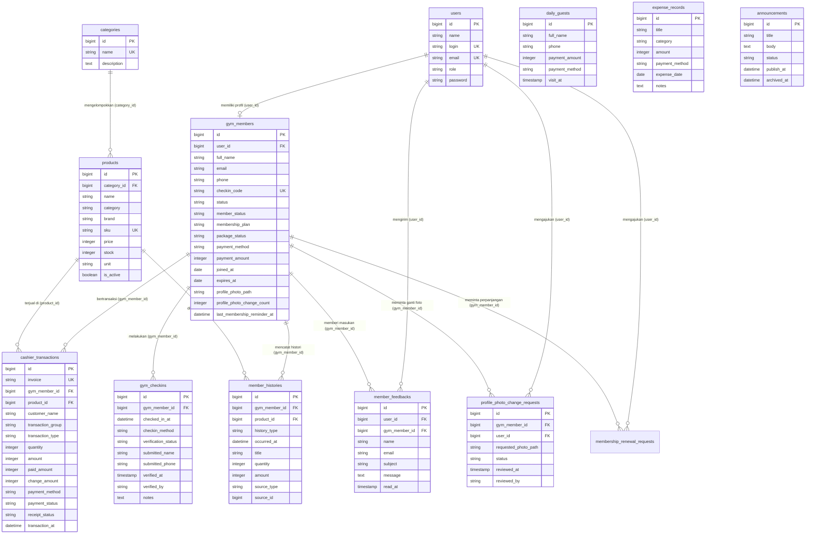
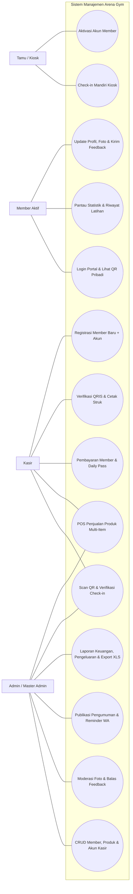
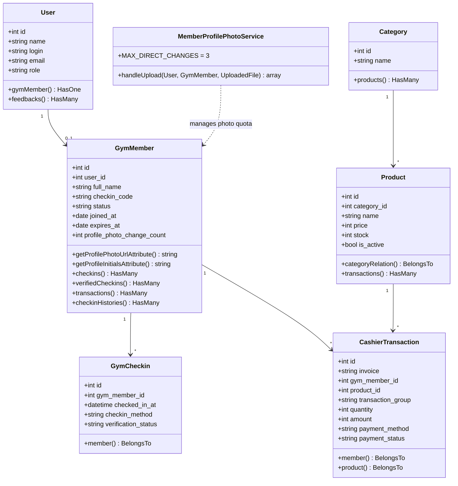
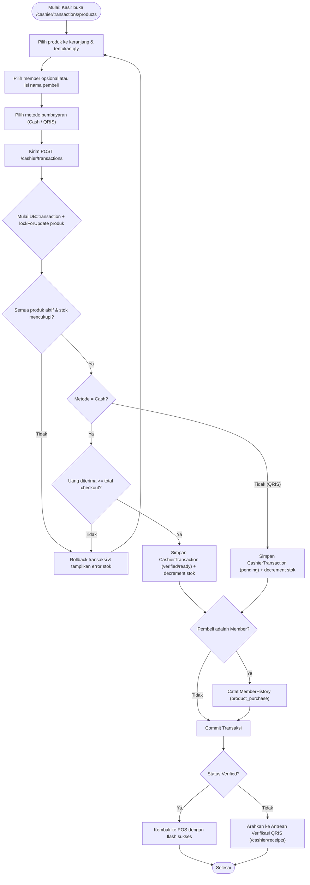
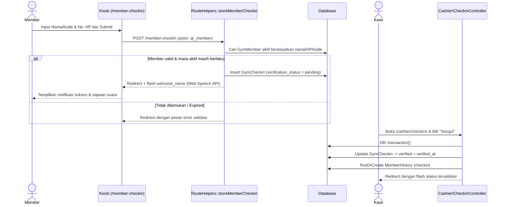
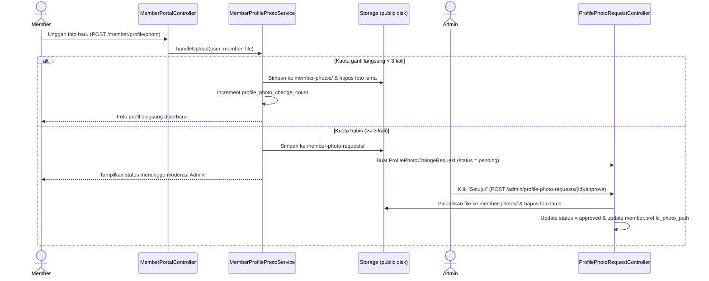

# Dokumentasi Lengkap Sistem Manajemen Arena Gym & Fitness

Dokumen ini disusun sebagai dokumentasi teknis dan perancangan perangkat lunak untuk sistem informasi **Arena Gym & Fitness**, mencakup **Arsitektur Sistem**, **Design System**, **Entity Relationship Diagram (ERD)**, serta **Unified Modeling Language (UML)** yang mencerminkan implementasi kode aktual berbasis **Laravel 12 + Inertia.js + React + Tailwind CSS v4**.

---

## 1. Arsitektur Sistem & Pemisahan Tanggung Jawab (Clean MVC)

Sistem dibangun menggunakan pola **Inertia.js Monolith-SPA**: Laravel bertindak sebagai pengelola routing, otentikasi/otorisasi berbasis peran (`EnsureRole`), validasi, dan transaksi basis data; sementara antarmuka pengguna dirender secara reaktif oleh **React** menggunakan komponen **Tailwind CSS v4**.

### 1.1 Aktor & Hak Akses (`EnsureRole`)

| Peran (`users.role`) | Deskripsi Hak Akses | Panel Tujuan |
| :--- | :--- | :--- |
| `master_admin` | Akses penuh ke modul Admin dan modul Kasir POS | `/admin` & `/cashier` |
| `admin` | Kelola member, daily pass, produk & kategori, pengumuman, moderasi foto, feedback, akun kasir, laporan & ekspor Excel | `/admin` |
| `cashier` | Scan & verifikasi check-in QR, perpanjangan member, daily pass, POS penjualan produk, registrasi member baru, verifikasi QRIS, cetak struk | `/cashier` |
| `member` | Portal Member (QR pribadi, riwayat latihan, statistik, pesan pengumuman, info paket, profil & kritik saran). Otomatis diblokir jika `expires_at` telah lewat | `/member/dashboard` |
| Kiosk / Tamu | Pengisian check-in mandiri tanpa login melalui `/member-checkin` dan aktivasi akun member melalui `/member/activate` | `/member-checkin` |

### 1.2 Struktur Layer Aplikasi Backend

- **Middleware**:
  - `App\Http\Middleware\HandleInertiaRequests` — membagikan props global (`appName`, `auth`, `flash`, `memberNotifications`, `adminBadges`).
  - `App\Http\Middleware\EnsureRole` — memvalidasi sesi peran (`admin`, `cashier`, `member`) dan memeriksa status aktif membership secara real-time.
- **Service & Helper**:
  - `App\Services\MemberProfilePhotoService` — mengelola kuota ganti foto langsung (maksimal `3` kali) dan pengajuan moderasi foto admin (`ProfilePhotoChangeRequest`).
  - `App\Services\WhatsAppGatewayService` & `App\Helpers\WhatsAppHelper` — penyusunan pesan pengingat jatuh tempo dan tautan berbagi saluran WhatsApp.
  - `App\Helpers\RouteHelpers` — agregasi statistik dashboard kasir via SQL aggregate, pencatatan check-in atomik (`DB::transaction`), dan kalkulasi perpanjangan siklus tanggal (`addMonthsNoOverflow`).
- **Controllers** (`app/Http/Controllers/`):
  - `Auth\LoginController`
  - `Kiosk\MemberCheckinController`
  - `Member\MemberAuthController`, `Member\MemberPortalController`
  - `Admin\DashboardController`, `MemberController`, `DailyPassController`, `ProductController`, `CheckinController`, `AnnouncementController`, `ProfilePhotoRequestController`, `FeedbackController`, `CashierAccountController`, `ReportController`
  - `Cashier\DashboardController`, `CheckinController`, `MemberPaymentController`, `DailyPaymentController`, `TransactionController`, `ReceiptController`

---

## 2. Design System

Antarmuka website dirombak menyeluruh menggunakan **React + Tailwind CSS v4** dengan dukungan penuh **Dark Mode & Light Mode** (`localStorage['arena-gym-theme']`).

### 2.1 Palet Warna & Token Semantik

| Token / Peran | Light Mode | Dark Mode | Kegunaan |
| :--- | :--- | :--- | :--- |
| **Canvas Utama** | `bg-slate-50` (`#f8fafc`) | `dark:bg-slate-950` (`#020617`) | Latar belakang utama halaman |
| **Surface Card** | `bg-white` + `border-slate-200/80` | `dark:bg-slate-900` + `dark:border-slate-800` | Kartu, tabel, modal, dan form |
| **Aksen Utama (Brand)** | Gradient `from-rose-600 to-orange-500` | Gradient `from-rose-600 to-orange-500` | CTA primer, item navigasi aktif, progress bar |
| **Success / Aktif** | `emerald-600` / `emerald-500/15` | `emerald-400` / `emerald-500/15` | Status aktif, pembayaran terverifikasi, check-in sah |
| **Warning / Pending** | `amber-500` / `amber-500/15` | `amber-300` / `amber-500/15` | Jatuh tempo ≤7 hari, QRIS pending, antrean verifikasi |
| **Danger / Expired** | `rose-600` / `rose-500/15` | `rose-400` / `rose-500/15` | Expired, penolakan, aksi hapus |
| **Info / Kategori** | `sky-600` / `sky-500/15` | `sky-300` / `sky-500/15` | Badge informasi dan kategori produk |

### 2.2 Tipografi

- **Sans Utama**: `Outfit` (Google/Bunny Fonts) — tegas dan modern untuk heading, KPI angka, tombol, dan navigasi.
- **Display / Monospace Aksen**: `Space Grotesk` & font monospace — untuk nomor invoice (`MBR-...`, `PRD-...`, `DP-...`), kode QR check-in (`AG-...`), dan struk kasir.

### 2.3 Komponen Standar (`resources/js/Components/UI.jsx` & `Layouts/`)

- **Layouts**:
  - `GuestLayout.jsx`: Halaman autentikasi & kiosk dengan ambient gradient dan toggle tema.
  - `AppLayout.jsx`: Sidebar responsif (slide-over pada mobile) untuk Admin & Kasir, menampilkan badge notifikasi pending secara real-time.
  - `MemberLayout.jsx`: Navbar atas untuk desktop dan *bottom navigation bar* untuk mobile, dilengkapi banner peringatan jatuh tempo dan modal saluran WhatsApp.
- **Atom & Molekul UI**: `Button` (6 varian, 4 ukuran), `Card`, `StatCard`, `Badge`, `Input`, `Select`, `Textarea`, `InputLabel`, `FieldError`, `Modal`, `Pagination`, `FlashBanner`, `EmptyState`, dan `ThemeToggle`.

---

## 3. Entity Relationship Diagram (ERD)

---

## 4. Diagram UML Lengkap

### 4.1 Use Case Diagram

### 4.2 Class Diagram (Model & Service Inti)

### 4.3 Activity Diagram — POS Penjualan Produk Multi-Item (Kasir)

### 4.4 Sequence Diagram — Check-in QR Mandiri & Verifikasi Kasir

### 4.5 Sequence Diagram — Pengajuan Ganti Foto Profil Member

---

## 5. Daftar Peningkatan Efisiensi & Perbaikan Bug dari Sistem Awal

1. **Dekomposisi Rute Monolitik ke Controller**: Memecah ribuan baris *route closure* di `routes/member.php`, `routes/admin/*.php`, dan `routes/cashier/*.php` ke 19 controller terstruktur plus `MemberProfilePhotoService`.
2. **Optimasi Query Dashboard Kasir**: `RouteHelpers::buildCashierViewData()` sebelumnya memuat seluruh tabel `cashier_transactions` ke memori PHP; kini menggunakan agregasi SQL langsung (`SUM`, `COUNT`, `GROUP BY`) dan membatasi antrean pending QRIS terbaru (`limit(15)`).
3. **Transaksi Atomik & Anti Race Condition pada POS**: `Cashier\TransactionController::store()` membungkus validasi stok, pencatatan transaksi, pencatatan `MemberHistory`, dan pengurangan stok dalam `DB::transaction()` disertai `lockForUpdate()`.
4. **Penyatuan Portal Login Satu Pintu & Keamanan Role**: `Auth\LoginController` kini mengimplementasikan **satu halaman login terpadu (`/login`) untuk seluruh peran** (Master Admin, Admin, Kasir, dan Member) tanpa perlu memilih tombol peran secara manual. Sistem secara otomatis mendeteksi role pengguna berdasarkan akun/email, memvalidasi password, memeriksa masa aktif membership (`EnsureRole::isMemberMembershipActive`), dan mengarahkan pengguna langsung ke panel tujuan masing-masing. Rute login lama (`/member/login`, `/login/admin`, `/login/cashier`, dll.) otomatis dialihkan ke `/login`.
5. **Sinkronisasi Transaksi Perpanjangan & Akun**: `Admin\MemberController::update()` memperbaiki pencatatan `transaction_group` dari `'membership'` menjadi `'member_payment'` (agar masuk ke laporan pendapatan member), menyinkronkan perubahan nama/email ke tabel `users`, serta membersihkan akun `User` saat member dihapus.
6. **Perbaikan Data Laporan Keuangan & Stok**: `Admin\ReportController` menghapus data dummy statis pada *Laporan Keuangan* sehingga menampilkan pemasukan dan pengeluaran aktual dari basis data, serta menyertakan seluruh master produk (termasuk yang belum terjual) di *Laporan Stok Barang*.
7. **Perbaikan Path Penyimpanan Foto Moderasi**: `Admin\ProfilePhotoRequestController` kini menggunakan `storage_path('app/public/...')` dan `Storage::disk('public')` secara konsisten saat menampilkan maupun menyetujui foto member.

